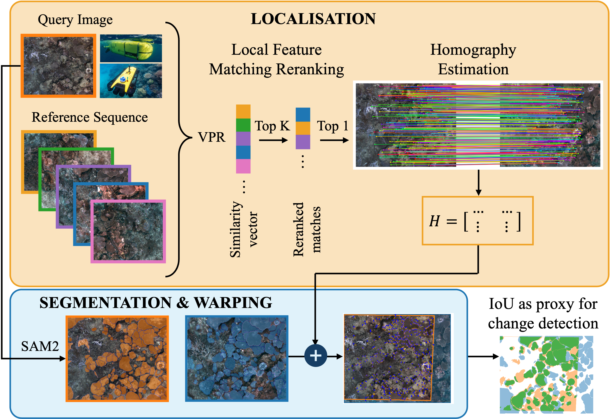
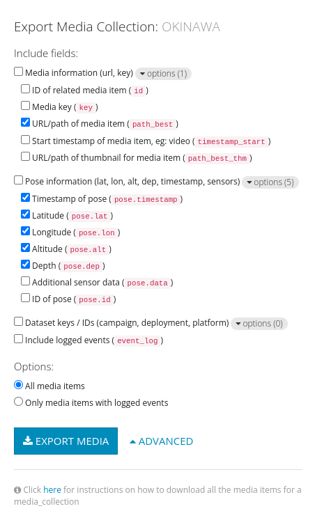

<p align="center">

  <h1 align="center"> UnderLoc </h1>
  <h3 align="center">Image-Based Relocalization and Alignment for Long-Term Monitoring of Dynamic Underwater Environments</h3> 
  <p align="center">
    <a href="https://github.com/bev-gorry"><strong>Beverley Gorry</strong></a>
    ·
    <a href="https://scholar.google.com/citations?hl=en&user=eq46ylAAAAAJ"><strong>Tobias Fischer</strong></a>
    ·
    <a href="https://scholar.google.com/citations?user=TDSmCKgAAAAJ&hl=en"><strong>Michael Milford</strong></a>
    .
    <a href="https://scholar.google.com/citations?user=SDtnGogAAAAJ&hl=en"><strong>Alejandro Fontan</strong></a>
  </p>

##

  <p align="center">
    <a href="https://underloc.github.io/static/assets/UNDERLOC_GORRY-B_2025.pdf" align="center">Paper</a> | 
    <a href="https://arxiv.org/abs/2503.04096" align="center">arXiv</a> | 
    <a href="https://underloc.github.io/" align="center">Project Page</a>
  </p>



**UnderLoc** is an integrated pipeline that combines Visual Pace Recognition (VPR), feature matching, and image segmentation on video-derived images. This method enables robust identification of revisited areas, estimations of rigid transformations, and downstream analysis of ecosystem changes. Furthermore, we introduce the **SQUIDLE+ VPR Benchmark**—the first large-scale underwater VPR benchmark designed to leverage an extensive collection of unstructured data from multiple robotic platforms, spanning time intervals from days to years. The dataset encompasses diverse trajectories, arbitrary overlap and diverse seafloor types captured under varying environmental conditions, including differences in depth, lighting, and turbidity.

This repository contains code for the paper "Image-Based Relocalization and Alignment for Long-Term Monitoring of Dynamic Underwater Environments."

<!-- The article can be found on <a href="">arXiv</a>. -->

## Getting Started

We use the package management tool [**pixi**](https://pixi.sh/latest/). If you haven't installed [**pixi**](https://pixi.sh/latest/) yet, run the following command in your terminal:

```bash
curl -fsSL https://pixi.sh/install.sh | bash
```

_After installation, restart your terminal or source your shell for the changes to take effect_. For more details, refer to the [**pixi documentation**](https://pixi.sh/latest/).

Clone the repository and navigate to the project directory:

```bash
git clone https://github.com/bev-gorry/underloc.git && cd underloc
```

## Quick Demo
A number of SQUIDLE+ VPR Benchmark datasets can be downloaded using the provided csv files under **~/underloc/datasets/squidle_csv**. By default, the demo will download the **OKINAWA (2016, 2017, 2018)** dataset. This can be modified in the default input file **~/underloc/arguments/args_dataset.yaml** or by providing your own yaml file (see **Configure Your Own Experiments**).
<br> 

To download a [**SQUIDLE+**](https://squidle.org/geodata/explore?action=newcollection#map) dataset and run the entire pipeline, including all implemented VPR methods:

```bash
pixi run create_squidle_dataset
pixi run pipeline
```
**Please note that this may take some time as each VPR method executes consecutively. Downloading the demo dataset will take approximately 10 minutes.**

<br>

To run only one VPR method (**megaloc** by default):
```bash
pixi run vpr
```
This will output a groundtruth distance matrix, the similarity matrix, visualizations of the top 20 results based on their similarity, and a PR curve of this method alone.

Once a VPR method has been executed and the similarity matrix exists, run hierarchical feature matching:
```bash
pixi run superpoint-h
```
**Note:** Hierarchical feature matching uses the results from **megaloc**. Ensure that an experiment for your dataset has been run with `vpr_method: megaloc` in the yaml file first, or modify the following line in **~/underloc/featurematching/superpoint_hierarchical.py** to run it on top of a different method.
```
99  vpr_method = 'megaloc'
```


## Add a SQUIDLE+ Dataset

Datasets in the benchmark are stored in a folder named **SQUIDLE-VPR-BENCHMARK**, which is created by default in the same parent directory as **underloc**.

1. To add a new dataset, visit [**SQUIDLE+**](https://squidle.org/geodata/explore?action=newcollection#map) and add your sequences to a new collection. Export the collection as a CSV file, ensuring that the export options are as follows:



2. Place the CSV file into the folder **~/underloc/datasets/squidle_csv** and adjust the corresponding YAML configuration file **~/underloc/arguments/args_dataset.yaml**.

3. Run `pixi run create_squidle_dataset`  to create the dataset in the benchmark. Your dataset will be created with the following structure:

```
~/SQUIDLE-VPR-BENCHMARK
└── YOUR_DATASET
    └── sequence_01
        ├── rgb
            └── img_01
            └── img_02
            └── ...
        ├── calibration.yaml
        ├── groundtruth.csv
        ├── groundtruth.txt
        └── rgb.txt
    └── sequence_02
        ├── ...
    └── ...
```

This dataset structure is designed to replicate [**VSLAM-LAB**](https://github.com/alejandrofontan/VSLAM-LAB), so that the same sequences can be used to test the extensive range of SLAM baselines available.

## Configure Your Own Experiments
To download any SQUIDLE+ dataset, ensure that the csv file exists with the exported fields above and provide the csv filepath and dataset path in your own .yaml file. Then run the pipeline with the fields set to your dataset.
```bash
ARGUMENT="arguments/args_dataset_sthelens.yaml" pixi run create_squidle_dataset
ARGUMENT="arguments/args_exp_sthelens.yaml" pixi run pipeline
```

### Fields in the YAML File
`benchmark`: Path to the folder containing datasets for experiments. It is `../../SQUIDLE-VPR-BENCHMARK` by default. Change this field if your datasets are stored elsewhere.
\
`vpr_method`: The method to be tested with `vpr-methods-evaluation`.
\
`vpr_loc_radius`: Localisation radius (meters) for a VPR match to be considered a true positive (ground truth positive).
`vpr_similarity_threshold`: The similarity threshold for a VPR match to be considered correct. This is only for visualization purposes (red or green box around the image in `save_top_n`) and not evaluation.
\
`log_path`: Directory containing the log files and results for this experiment. The path will be automatically appended with the dataset and method, so one experiment can have the following structure by only changing the `dataset`/`query_folder`/`dbs_folder` and running `pixi run demo_pipeline` which will run all VPR methods.

```
~/logs
└── experiment_01
    └── okinawa
        ├── cosplace
        ├── evaluation
            └── evaluation.txt
            └── okinawa_precision_recall_curve_LR-5.png
            └── ...
        ├── megaloc
            └── megaloc_distance_matrix.npy
            └── megaloc_similarity_matrix.npy
            └── ...
        ├── netvlad
        ├── superpoint-brute-force
        └── superpoint-hierarchical
    └── sthelens
        ├── anyloc-unstructured
        ├── cosplace
        ├── cricavpr
        ├── evaluation
        └── ...
    └── ...
└── experiment_02
    └── ...
```
\
`visualize`: `true`/`false` flag to show plots as they are generated (after saving), or only save to the log file. Set this to `false` if you want to run an experiment without stopping to close plots.
\
`dataset`: The name of the dataset use in the experiment. **NOTE: This must match the name of the dataset in your benchmark.**
\
`query_folder`: The name of the sequence to be used as the query. **NOTE: This must match the name of a folder within your dataset folder.**
\
`dbs_folder`: The name of the sequence to be used as the database/reference set. **NOTE: This must match the name of a the folder within your dataset folder.**

<!-- ## License
**UnderLoc** is released under a **LICENSE.txt**. For a list of code dependencies which are not property of the authors of **UnderLoc**, please check **docs/Dependencies.md**. -->

## Included Repositories

The following forked repositories are included in **UnderLoc** to enable evaluation of VPR methods, local feature matching, and semantic segmentation.

- [VPR-methods-evaluation](https://github.com/gmberton/VPR-methods-evaluation)
- [LightGlue](https://github.com/cvg/LightGlue)
- [SAM2](https://github.com/facebookresearch/sam2)

## Citation

Thanks for using our work. You can cite it as:

```bibtex
@inproceedings{gorry2025imagebasedrelocalizationalignmentlongterm,
    title={Image-Based Relocalization and Alignment for Long-Term Monitoring of Dynamic Underwater Environments},
    author={Beverley Gorry and Tobias Fischer and Michael Milford and Alejandro Fontan},
    booktitle={IEEE/RSJ Conference on Intelligent Robots and Systems},
    year={2025},
}
```

We also encourage citing [VPR-methods-evaluation](https://github.com/gmberton/VPR-methods-evaluation), [MegaLoc](https://arxiv.org/abs/2502.17237), [LightGlue](https://github.com/cvg/LightGlue), and [SAM2](https://github.com/facebookresearch/sam2).

## Acknowledgements

This research was partially supported by funding from ARC Laureate Fellowship FL210100156 to MM and ARC DECRA Fellowship DE240100149 to TF. The authors acknowledge continued support from the Queensland University of Technology (QUT) through the Centre for Robotics.

We would particularly like to acknlowedge the authors of [VPR-methods-evaluation](https://github.com/gmberton/VPR-methods-evaluation), [MegaLoc](https://arxiv.org/abs/2502.17237), [LightGlue](https://github.com/cvg/LightGlue), [SAM2](https://github.com/facebookresearch/sam2), and [VSLAM-LAB](https://github.com/alejandrofontan/VSLAM-LAB).
